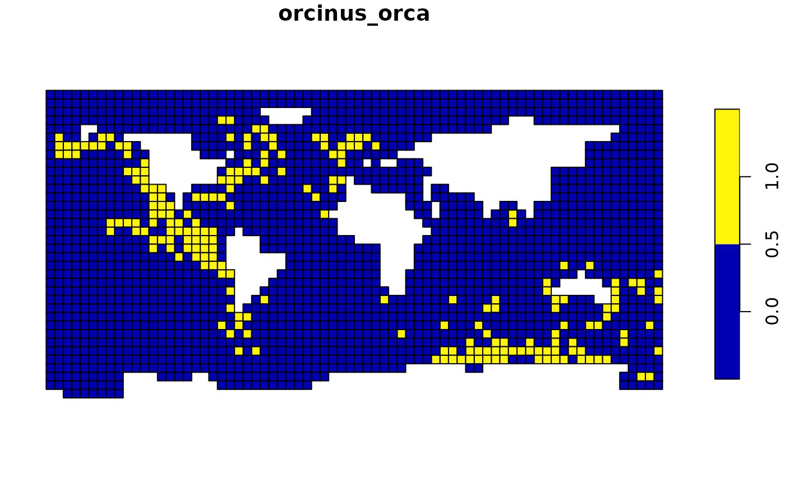
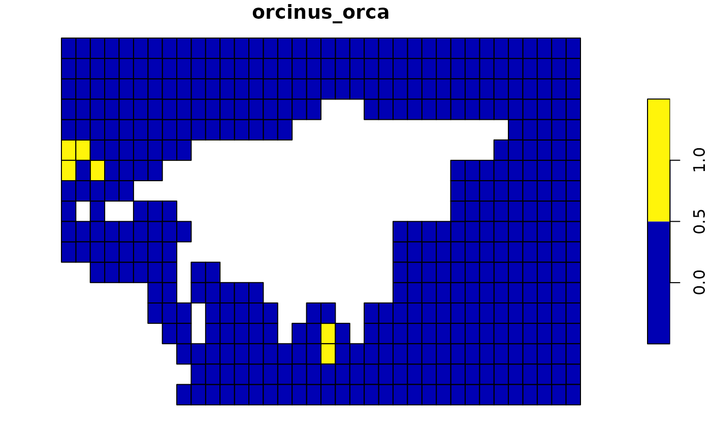

# Wildcards

## What are wildcards?

Wildcards are special characters that represent any valid alternative
character. In the context of c-squares, wildcards can be used to
compactly notate a range of raster cells. Let’s say you have the
following string of four c-squares defined:

``` r

library(csquares)

csq <- as_csquares("1000:1|1000:2|1000:3|1000:4")

print(csq)
#>  csquares [1:1]   4 squares
```

These are four squares of 5° by 5°. As you can see the first four digits
of each of the four squares are identical. Therefore, these squares
could be notated as `"1000:*"` where `*` is the wildcard symbol. The
wildcard thus represent each of the four possible values that are
allowed at its position. Constructing a `csquares` object with
[`as_csquares()`](https://pepijn-devries.github.io/csquares/reference/as_csquares.md)
results in an identical object when the either the long format or the
compact notation with wildcard is used.

``` r

csqw <- as_csquares("1000:*")

print(csqw)
#>  csquares [1:1]   4 squares

identical(csq, csqw)
#> [1] TRUE
```

## Expanding wildcards

*‘Ceci n’est pas une pipe’*

The `csquares` object does not store wildcards, as it will use the
expanded format with explicit notation, where each raster cell is
included in the character string and is separated by the pipe `"|"`
character. The function
[`as_csquares()`](https://pepijn-devries.github.io/csquares/reference/as_csquares.md)
wraps a call to
[`expand_wildcards()`](https://pepijn-devries.github.io/csquares/reference/expand_wildcards.md)
which expands c-square codes containing wildcards. It will replace the
short notation with wildcard by pipe separated csquares codes.

``` r

expand_wildcards("1000:*") |>
  as.character()
#> [1] "1000:1|1000:2|1000:3|1000:4"
```

## Matching wild cards

Wildcards can also be used to query spatial data and select specific
blocks of raster cells. When used for searching, the wildcard is
sometimes represented by the percentage character instead of an
asterisk. For this R package it doesn’t matter. Bother characters are
interpreted exactly the same.

The example below shows how you can filter a specific quadrant from the
global killer whale data set using a wildcard notation.

``` r

library(dplyr, warn.conflicts = FALSE)
library(sf, warn.conflicts = FALSE)
#> Linking to GEOS 3.14.1, GDAL 3.12.2, PROJ 9.7.1; sf_use_s2() is TRUE

orca_sf <-
  orca |>
  as_csquares(csquares = "csquares") |>
  st_as_sf()

plot(orca_sf["orcinus_orca"])
```



``` r


## Note that the first number in the csquares code (1)
## represents the North East quadrant
## The remainder of the code consists of wildcards.
plot(
  orca_sf |>
    filter(
      in_csquares(csquares, "1***:*")
    ) |>
    drop_csquares() |>
    select("orcinus_orca")
)
```



### Mode

Consider the following `csquares` object:

``` r

csq_example <- as_csquares(c("1000:100|1000:111|1000:206|1000:207", "1000:122"))
```

It is a `vector` of two elements, the first containing 4 squares, the
second 1 square. Let’s say we want to check if `"1000:1**"` matches with
any of the elements in the `vector`.

``` r

in_csquares(csq_example, "1000:1**")
#> [1] TRUE TRUE
```

Which is `TRUE` for both elements in the vector. This makes sense as
both elements indeed contain csquares codes that match with
`"1000:1**"`. However, the first element also contains elements that
don’t match. The reason that the example still returns `TRUE` in both
cases is because the `mode` is set to `"any"`. Meaning that it will
return `TRUE` if any of the codes in an element matches. You should set
the mode to `"all"` if you only want a positive match when all codes in
an element match:

``` r

in_csquares(csq_example, "1000:1**", mode = "all")
#> [1] FALSE  TRUE
```

### Strict

Now, let’s compare the same `csquares` object with `"1000:*"` which has
a lower resolution than the squares in the object:

``` r

in_csquares(csq_example, "1000:*")
#> [1] TRUE TRUE
```

Again, it matches with all elements in the `vector`, even though the
resolution is different. This is because
[`in_csquares()`](https://pepijn-devries.github.io/csquares/reference/in_csquares.md)
isn’t very strict by default. Meaning that it will also match with any
‘child’ square with a higher resolution. If you want a strict match
where the resolution also matches use `strict = TRUE`:

``` r

in_csquares(csq_example, "1000:*", strict = TRUE)
#> [1] FALSE FALSE
```
