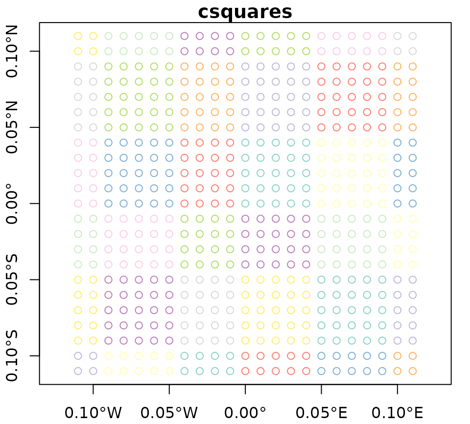
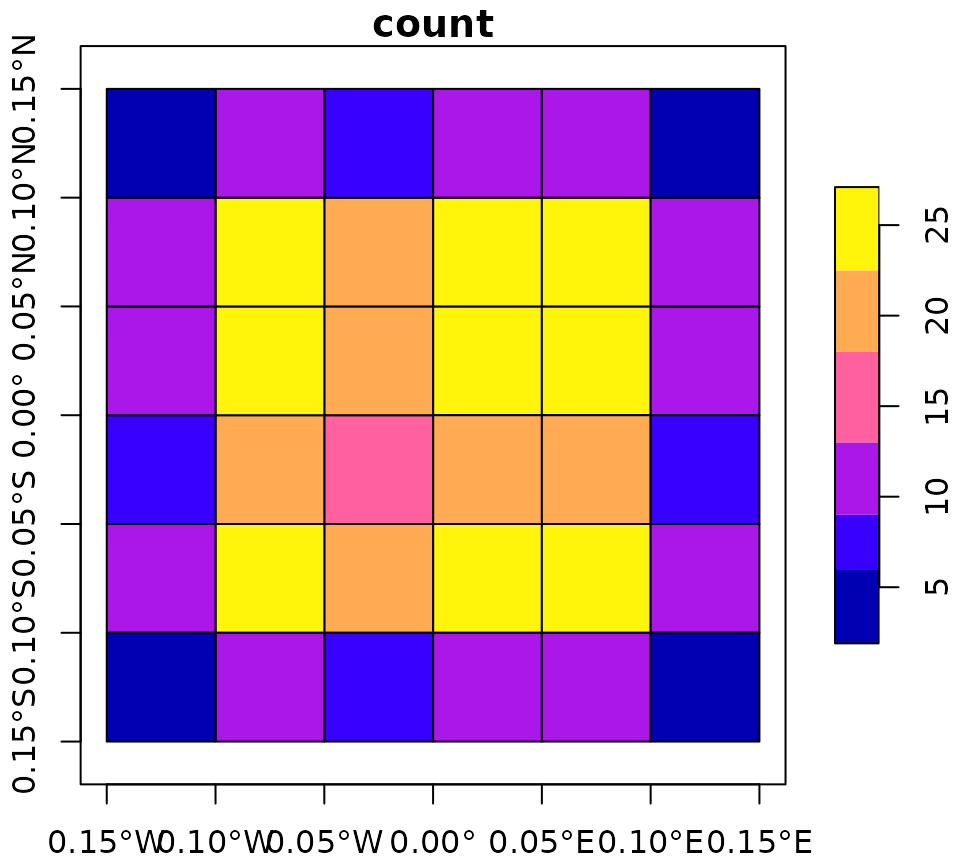

# On the Edge

``` r

library(csquares)
library(sf)
library(dplyr)
```

When working with grid encoding systems like CSquares, you should be
aware of boundary cases. This is demonstrated with a set op evenly
distributed points:

``` r

pts <-
  expand.grid(
    x = seq(-0.11, 0.11, by = 0.01),
    y = seq(-0.11, 0.11, by = 0.01)
  ) |>
  sf::st_as_sf(coords = c("x", "y"), crs = 4326)
```

Note that some of these points are exactly on CSquare cell boundaries,
depending on the selected resolution. So, what happens with these points
when assigning them to specific CSquare cells? Let’s see:

``` r

csq <- as_csquares(pts, resolution = 0.05)
plot(csq, axes = TRUE)
```



If we count the number of points in each Csquare cell you will notice
something interesting.

``` r

csq_agg <- summarise(csq |> group_by(csquares), count = n())
plot(csq_agg["count"], axes = TRUE)
```



You will see an artifact near the Equator and at the Prime Meridian.
Even though the points are distributed homogeneously over space, lower
number of points are counted near these lines. Why is this?

This is because of how Rees (2015) defined boundary cases for assigning
CSquares codes to geo-referenced points: it follows a strict
“lower-limit inclusive” convention.

Any grid encoding system would suffer from some form of boundary
assumptions and artifacts. This often occurs at the edges of the area
covered by the system. But in case of the CSquares, this occurs near the
Prime Meridian and Equator.

## When worry about boundary effect?

When locations are measured with precision that causes data to snap to
CSquare cell bounds. This could cause an issue. The same is true if
there are physical bounds or other reasons for the data to snap to cell
bounds. This is true for any grid encoding system. So, you should never
encode data to a resolution that surpasses your data precision

If your measured locations are affected by random processes and is
sufficiently precise, points will fall on either side of a cell
boundary. Cases where they are exactly on the boundary should be
extremely rare.

So this becomes especially a challenge when the number of locations is
limited and / or when the required resolution is fine compared to
location precision.

## Handling boundary effects

If your data for some reason snaps exactly to cell boundaries, you could
add some jitter to the location (only a fraction of the resolution of
your grid), causing the point to randomly fall on either side of the
boundary. To understand if and how this affects your analysis, you could
perform a Monte Carlo simulation with the jittering.

If you don’t want these artifacts to occur near the Prime Meridian or
Equator, you could also chose to convert your CSquares grid to a
[stars](https://r-spatial.github.io/stars/) object, and drop the
CSquares encoding. You can then use
[`sf::st_within`](https://r-spatial.github.io/sf/reference/geos_binary_pred.html)
or
[`sf::st_intersects`](https://r-spatial.github.io/sf/reference/geos_binary_pred.html)
to assign points to the cells. Whichever method you chose, always
document what you have done and why.

Furthermore, the selection of a appropriate scale for your grid encoding
is key. You should always be aware effects cell size can have on your
data processing.

## References

- Rees, T. (2015); ““C-Squares,” A New Spatial Indexing System and its
  Applicability to the Description of Oceanographic Datasets”
  Oceanography 16(1), 11-19 <https://doi.org/10.5670/oceanog.2003.52>
