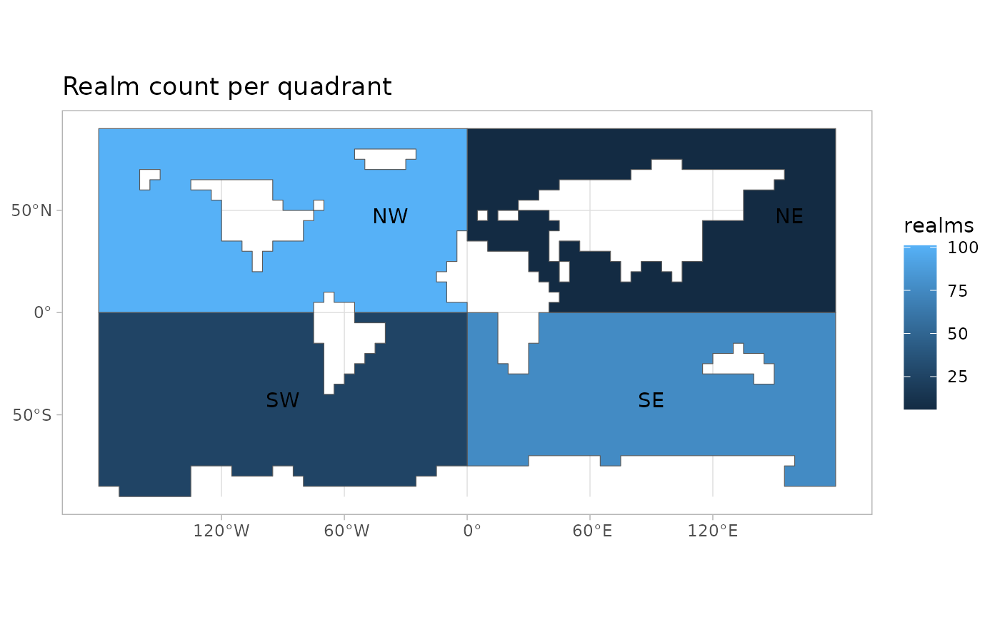

# Tidy csquares

## The Csquares family

`csquares` objects can inherit properties from different parents as
illustrated in
[`vignette("csquares-objects")`](https://pepijn-devries.github.io/csquares/articles/csquares-objects.md).
When a `csquares` object inherits from the class
[`data.frame()`](https://rdrr.io/r/base/data.frame.html), you can apply
many [tidyverse](https://tidyverse.org/) operations while preserving the
`csquares` properties of the object. When you create a `csquares` object
from a [`character()`](https://rdrr.io/r/base/character.html), you
cannot use tidyverse operations as it doesn’t inherit the
[`data.frame()`](https://rdrr.io/r/base/data.frame.html) class. You can
check which ancestors your object has by calling
[`class()`](https://rdrr.io/r/base/class.html) as shown in the example
below.

``` r

## Required libraries
library(csquares)
library(dplyr)
library(sf)
library(ggplot2)

## create a simple csquares object:
char_csq <- as_csquares(c("1000", "3000"))

## This simple objects has "character" as parent class.
## So tidyverse is out of the question here.
class(char_csq)
#> [1] "csquares"   "character"  "vctrs_vctr"
```

So let’s start by creating a `csquares` object that does inherit from
the [`data.frame()`](https://rdrr.io/r/base/data.frame.html) class. It
will be used in examples shown in this vignette.

``` r

## create a csquares object with geometries:
orca_csq  <- orca |> as_csquares(csquares = "csquares")

## It inherits the class data.frame.
class(orca_csq)
#> [1] "csquares"   "data.frame"
```

## Tidyverse operations

All tidyverse (and base) methods implemented in the Csquares package end
with the suffix `.csquares`. You should never call these functions
directly as this will likely produce errors. Instead, load the packages
that implement the generic method (e.g., `dplyr` for
[`mutate()`](https://dplyr.tidyverse.org/reference/mutate.html) and
[`summarise()`](https://dplyr.tidyverse.org/reference/summarise.html);
`tidyr` for
[`pivot_wider()`](https://tidyr.tidyverse.org/reference/pivot_wider.html);
`sf` for
[`st_as_sf()`](https://pepijn-devries.github.io/csquares/reference/st_as_sf.md)
etc.). Then call the method without the `.csquares` suffix as shown in
the examples below. As you call the method on `csquares` objects, the
correct implementation of the generic method will be dispatched
automatically.

The example below shows how you can mutate a column in a `csquares`
object, then group by a specific column and summarise it. The csquares
properties are grouped automatically. If the `csquares` object inherits
spatial features, the geometries are recalculated after summarising.

``` r

orca_sum <-
  orca_csq |>
## Add geometries to the object
  st_as_sf() |>
  ## use `mutate` to create a column that contains the csquares' quadrant
  mutate(quadrant = recode_values(
           substr(csquares |> as.character(), 1L, 1L),
           "1" ~ "NE", "3" ~ "SE", "5" ~ "SW", "7" ~ "NW")) |>
  ## grouping by the column with logical values and summarising
  ## will reduce the number of rows to 4 (one for each quadrant)
  group_by(quadrant) |>
  summarise(realms = sum(orcinus_orca), .groups = "keep")

## Note that csquares are automatically concatted and
## geometries recalculated
ggplot(orca_sum) +
  geom_sf(aes(fill = realms)) +
  geom_sf_text(aes(label = quadrant)) +
  coord_sf() +
  labs(title = "Realm count per quadrant", x = NULL, y = NULL)
```



Printing the summarised object shows that there are only two rows left.
One for each value in the grouped column.

``` r

orca_sum
#> Simple feature collection with 4 features and 3 fields
#> Geometry type: POLYGON
#> Dimension:     XY
#> Bounding box:  xmin: -180 ymin: -90 xmax: 180 ymax: 90
#> Geodetic CRS:  WGS 84
#> # A tibble: 4 × 4
#> # Groups:   quadrant [4]
#>   quadrant realms csquares                                                  geom
#> * <chr>     <int> <csquares>                                       <POLYGON [°]>
#> 1 NE            6 1004:1|1004:2|1004:4|1005:1|1005:2|… ((10 35, 5 35, 0 35, 0 4…
#> 2 NW          101 7000:1|7000:2|7001:1|7001:2|7001:3|… ((-180 10, -180 15, -180…
#> 3 SE           76 3000:1|3000:2|3000:3|3000:4|3001:1|… ((0 -55, 0 -50, 0 -45, 0…
#> 4 SW           26 5000:1|5000:2|5000:3|5000:4|5001:1|… ((-180 -85, -180 -80, -1…
```

## Join

Joining `csquares` objects is pretty straightforward and is only allowed
on objects that inherit from the `data.frame` class. An exception are
`csquares` objects that inherit from the `stars` class
([`stars::st_as_stars()`](https://r-spatial.github.io/stars/reference/st_as_stars.html)).
On those objects you are allowed to perform left joins, all other joins
are impossible. See also
[`?join`](https://pepijn-devries.github.io/csquares/reference/tidyjoins.md).

Below you see how you can simply join a `data.frame` to a `csquares`
object by the csquares code.

``` r

df <- data.frame(foo = "bar", csquares = "3603:3")

left_join(orca_csq, df, by = "csquares") |> print(max = 30)
#>         csquares orcinus_orca  foo
#> 1  S60 E 30 (5°)        FALSE  bar
#> 2  S60 W 40 (5°)        FALSE <NA>
#> 3  N10 W 90 (5°)         TRUE <NA>
#> 4  N 0 W 40 (5°)        FALSE <NA>
#> 5  S10 W 70 (5°)         TRUE <NA>
#> 6  N 0 W100 (5°)         TRUE <NA>
#> 7  N40 E 30 (5°)        FALSE <NA>
#> 8  N 0 W100 (5°)         TRUE <NA>
#> 9  S 0 W 10 (5°)        FALSE <NA>
#> 10 S40 E130 (5°)         TRUE <NA>
#>  [ reached 'max' / getOption("max.print") -- omitted 2048 rows ]
right_join(orca_csq, df, by = "csquares")
#>        csquares orcinus_orca foo
#> 1 S60 E 30 (5°)        FALSE bar
```

You are also allowed to join a `csquares` object to another `csquares`
by another column that does not represent the csquares codes:

``` r

csq <- data.frame(orcinus_orca = FALSE, csquares = "3603:3") |>
  as_csquares(csquares = "csquares")

left_join(orca_csq, csq, by = "orcinus_orca") |> print(max = 30)
#>       csquares.x orcinus_orca    csquares.y
#> 1  S60 E 30 (5°)        FALSE S60 E 30 (5°)
#> 2  S60 W 40 (5°)        FALSE S60 E 30 (5°)
#> 3  N10 W 90 (5°)         TRUE         empty
#> 4  N 0 W 40 (5°)        FALSE S60 E 30 (5°)
#> 5  S10 W 70 (5°)         TRUE         empty
#> 6  N 0 W100 (5°)         TRUE         empty
#> 7  N40 E 30 (5°)        FALSE S60 E 30 (5°)
#> 8  N 0 W100 (5°)         TRUE         empty
#> 9  S 0 W 10 (5°)        FALSE S60 E 30 (5°)
#> 10 S40 E130 (5°)         TRUE         empty
#>  [ reached 'max' / getOption("max.print") -- omitted 2048 rows ]
```

Note that the resulting `csquares` object has two columns with csquares
codes. Only the column from the left-hand table in the join is used for
further operations. However, you should wonder if this join is
meaningful when mismatching csquares codes are the result.

## Further reading

For some additional `csquares` specific examples check out
[`?tidyverse`](https://pepijn-devries.github.io/csquares/reference/tidyverse.md)
and
[`?join`](https://pepijn-devries.github.io/csquares/reference/tidyjoins.md).
For extensive documentation on tidy operations, consult the [tidyverse
website](https://tidyverse.org/).
